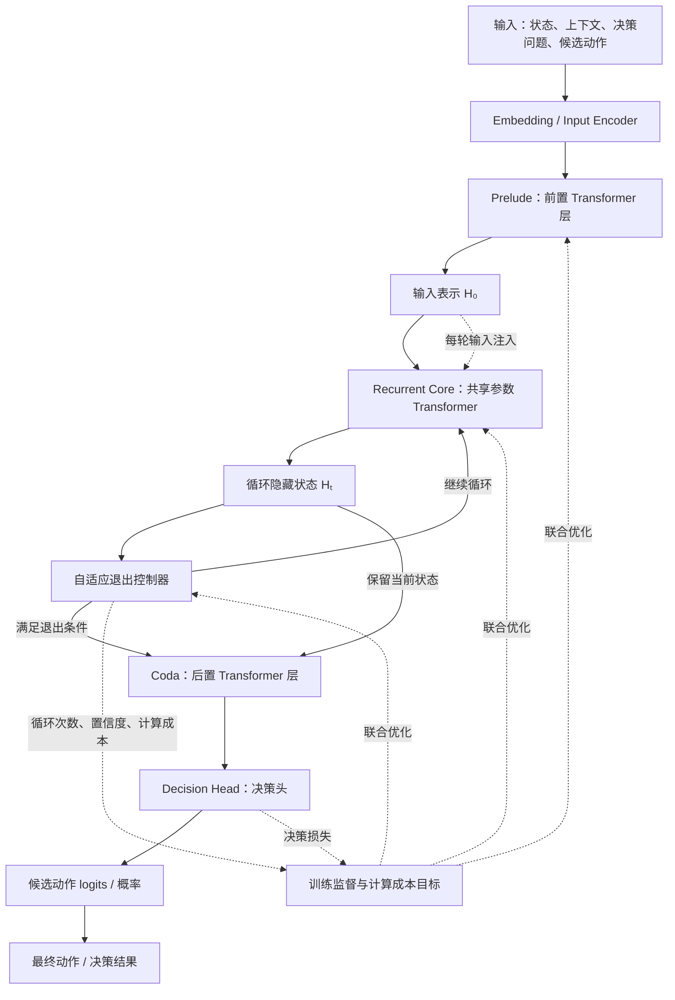

# 循环深度决策模型设计讨论（待定稿）V1

- **状态**：讨论阶段 / 未定稿。本文档不构成任何训练或 GPU 实验授权。
- **日期**：2026-10-23
- **目的**：存档"从头训练一个带循环深度的决策模型"的设计讨论与待定项，供对话压缩后无损恢复。阅读本文档应等价于阅读原讨论。
- **关联证据**：`docs/plans/S08_CAMPAIGN_LOG.md` §1–§33（0.8B HybridLoop 全程）；`results/` 下 t13/t14/e2/e3 系列；文献见 §6。

---

## 1. 设计来源与定位

用户决定：**从头训练**（from scratch）一个带循环深度的**决策模型**，架构从开源模型改造。原始输入为用户提供的框架图（flowchart，逐字结构如下）。

定位声明（讨论中已确认）：
- 这是"架构层参数效率"的验证载体——参数效率主张只在从头训练体制下成立（T-14 负结果 + Saunshi 文献归因，见 §5）。
- 与 0.8B HybridLoop（S08 适配路线）是两条独立证据链；本设计不声称验证 S08 适配法。
- 终点是决策任务（候选动作打分），不是语言建模。

### 框架图（用户提供，原文存档）

结构同族：Huginn-3.5B（Prelude/Core/Coda + 每轮输入注入）、S08 HybridLoop（l1gate 逐轮混合 + h0 重注入 + V4Router 逐迭代路由）。

---

## 2. 评审结论：与已验证证据的兼容性

1. **每轮输入注入**：与 S08 `inp = h_old + h0`（t≥2）同族，已在 0.8B 验证可行（E1/E2）。
2. **自适应退出的训练约束（硬性，不可省）**：
   - 梯度必须走**可微 continuation probability**（S08 Q1 修复后质量追平通过：adaptive CE − fixed_d2 = −0.0017）；S3 的 detach+硬阈值路径已证失败（+0.036 CE、审计出局）。
   - 成本惩罚须**退火进入**（先质量 warm-up，再开 ponder）；Q1 的 ponder warm-up 设计直接沿用。
3. **决策头 + 单答案输出的红利**：无生成循环、无 EOS 问题、无输出长度混淆轴；成本轴 = 纯循环轮数，参数效率账干净。T-13 整类问题（EOS、答案词表共享、标签翻转）在此框架下不存在。
4. **token 级退出明确排除**：Phase E 已判（纯推理侧真跳过语义崩坏，需部署语义训练）；决策任务天然**样本级退出**，恰好在已验证能力内。

---

## 3. 必须冻结的设计决策点（"具体内容待定"清单）

| # | 决策点 | 候选/建议 | 依据 |
|---|---|---|---|
| D1 | 退出控制器输入 | H_t + 轮次 t + 当轮决策置信度；停止条件用 **KL(pt‖pt-1) + 熵双条件** | Loop-Think-Generalize 实测：单 KL 过早停 |
| D2 | 逐轮监督 | 训练时**每轮都过 Coda+决策头**（多深度监督）；推理只在退出轮过 | S08 的 K-of-8 随机监督同角色；无逐轮信号则控制器学不到置信度 |
| D3 | 成本项形式与量纲 | ponder 惩罚 λ·E[轮数]，λ 退火曲线写入配方 | Q1 语义（Σp_t） |
| D4 | 退出粒度 | 样本级（一次决策一个退出点） | Phase E 结论 |
| D5 | 底座选型 | **普通 Transformer 块**（GPT-2 式）优先；除非有明确长上下文理由才用 GDN 混合 | Loop-Think-Generalize 同款已在本研究问题上验证；GDN 复杂度是 0.8B 适配路线的遗产，不必继承 |
| D6 | 输入注入形式 | 残差加（h + h0） | S08 已验证 |
| D7 | 循环块初始化 | ~~共享块输出投影零初始化（c_proj=0）~~ → **项目实测反证，改为小方差 std=0.02** | 原依据 Loop-Think-Generalize；但本项目实测精确零初始化使 qkv/up/ln 梯度全为 0，可训练容量塌缩，dev 停在随机基线。见 `LDM_CAMPAIGN_LOG.md` §4.1 |
| D8 | 训练深度策略 | **动态循环深度**（Poisson 采样 R∈[Rmin,Rmax]），不用固定深度 | 同文献：动态 > 固定（外推更强） |
| D9 | 轮数硬上限 | 设定 Rmax 并监控过思考（logit margin 先升后降现象） | 同文献：overthinking 实测存在 |

---

## 4. 风险登记表（每条带证据）

| 风险 | 证据 | 对策 |
|---|---|---|
| 退出学不会"少想"（开关不触发） | T-9：主深度 d2 训练出的 router，d*=1 在 100 题上零触发（eff∈[1.98,2.75]） | 从头训练 + 成本项自始存在（退火权重），让单轮直通成为可学选项 |
| 小规模下退出有质量代价 | S08 S3：0.8B +0.036 CE（4B 才零代价）；代价随规模缩小而升 | 预算留 grokking 级时长；D8 动态深度 |
| 过度思考（超量迭代降质） | Loop-Think-Generalize §6.3 实测 | D9 硬上限 + KL+熵停止（D1） |
| 优化不稳定 | 同文献 §4 | 小块径小方差初始化（精确零初始化实测切梯度，见 §4.1） |
| 适配体制污染结论 | T-14：稠密预训练+LoRA 适配不继承循环参数效率 | 本设计必须**纯从头训练**，任何预训练权重混入都要单列 |

---

## 5. 验证协议（沿用既定口径）

- **三对照**：(k⊗L) 循环 vs (k⊗1) 同参数稠密 vs (kL⊗1) 同算力稠密——缺一不可（缺 iso-flop 则无法分离"深度贡献"与"共享贡献"）。
- **多尺寸**：≥2-3 个规模点才能称"效率"（单点只是个案）。
- **任务族**：迭代型决策任务（T-13 式切分思路可复用：同分布 / 深度外推 / 组合留出 / 长度对照）+ 至少一个通用对照任务（测代价侧——Saunshi 发现记忆类任务循环吃亏，必须如实测）。
- **核心图**：参数-质量-轮数三方图；轮数-难度关联（难样本是否用更多轮）。
- **判读纪律**：循环 vs 同参数胜出 ≠ 参数效率；须对同算力稠密臂也有优势才算数。

---

## 6. 证据与文献索引

本项目证据（全部落盘）：
- S08 战役日志 §1–§33：`docs/plans/S08_CAMPAIGN_LOG.md`
- 适配路线参数效率负结果：`results/t14_param_eff.json` + §31–§32
- 退出训练语义修正：`runs/s08_qat_exit/`（Q1）+ §8–§11
- d*=1 不触发：`results/t9_dstar1.json` + §29
- token 级退出死刑：§12–§15（Phase E）
- 任务管线：`data/synth_multihop/` + `s57_t13_calibrate_task.py`（T-13）+ §31

文献（均已读原文核实）：
- Saunshi et al., *Reasoning with Latent Thoughts*（arXiv:2502.17416）：循环参数效率 from-scratch；pp-hop 与本任务族同构；推理强/记忆弱二分；middle-looping 变体。
- Kohli et al., *Loop, Think, & Generalize*（arXiv:2604.07822，COLM 2026）：grokking 三阶段；深度外推条件（R>4、动态深度、课程）；KL+熵停止；零初始化。
- Geiping et al., Huginn-3.5B（arXiv:2502.05171）：P-R-C 结构原型；from-scratch。
- MoR（arXiv:2507.10524，NeurIPS 2025）：路由与递归联合训练原则。
- Balesni et al., *Two-Hop Curse*（arXiv:2411.16353）：无 CoT 组合的天然难度。
- *Verbose ListOps*（arXiv:2506.04907）：干扰鲁棒性需训练期多样性。

---

## 7. 待定讨论项（未决，下轮继续）

1. **"类似 jev"指什么**：用户提及参考对象 "jev"，具体所指未确认（可能是某决策模型/项目）。待用户澄清后评估结构迁移性。
2. **任务域**：决策任务的具体形式未定（网格世界/棋盘/资源分配/合成规则决策？）。T-13 亲属多跳可直接改造为决策形式，或另起。
3. **规模与预算**：首版尺寸（百万级起步？）、训练卡时预算、是否本机 8GB 起步。
4. **与 0.8B HybridLoop 的关系**：论文叙事是"两条独立证据链"还是"适配路线 + 原生路线对照"。
5. **是否写实验注册文档（P0）**：评审已建议最小路径=小尺寸三对照先行；待用户拍板后立项。

---

## 8. 修订记录（append-only）

| 日期 | 事项 |
|---|---|
| 2026-10-23 | V1 初版：框架图存档 + 评审结论 + 待定项（依据 0.8B 全程证据与文献核实） |
| 2026-10-23 | 后续：四项主契约经用户确认冻结，§7 第 2/3 项（任务域、规模方向）已定；详见 `LOOPED_DECISION_MODEL_FEASIBILITY_SPEC_DRAFT_V1.md` V1.1 与 `LDM_CAMPAIGN_LOG.md` §1–§2（含数据集 v1 冻结）。"jev"（§7 第 1 项）仍未澄清 |
